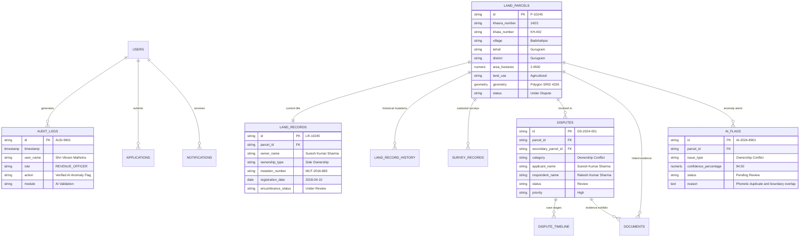

# BHUMI SETU 360° — DATABASE ARCHITECTURE & SCHEMA SPECIFICATION
**PostgreSQL 14+ with PostGIS Spatial Extension**

## 1. Overview
The Bhumi Setu 360° database architecture is engineered to model the complexity of Indian land records administration (e.g. Jamabandi, Aks Shajra, Mutation Sanad, and Cadastral Survey records). It integrates tabular revenue data with spatial GIS geometries using PostGIS.

---

## 2. Entity-Relationship Diagram (ERD)



---

## 3. Core Tables & Field Definitions

### `land_parcels`
Stores geographic boundaries, Khasra identifiers, and location attributes.
- `id` (VARCHAR PK): Unique cadastral parcel ID (e.g. `P-10245`).
- `khasra_number` (VARCHAR): Cadastral plot number.
- `village`, `tehsil`, `district` (VARCHAR): Administrative hierarchy.
- `area_hectares` (NUMERIC): Statutory declared area.
- `geometry` (GEOMETRY(Polygon, 4326)): PostGIS spatial boundary with GIST indexing.
- `status`: Verification lifecycle (`Verified`, `Under Dispute`, `Pending Survey`, `Flagged Inconsistent`).

### `land_records`
Statutory record of rights (Jamabandi/RoR) and title details.
- `id` (VARCHAR PK): Record ID (e.g. `LR-10245`).
- `parcel_id` (VARCHAR FK): Foreign key referencing `land_parcels.id`.
- `owner_name` (VARCHAR): Full name of the titleholder.
- `ownership_type`: `Sole Ownership`, `Joint/Ancestral`, `Corporate Ownership`, `State Government`.
- `mutation_number` (VARCHAR): Certified mutation sanction number.
- `registration_number` (VARCHAR): Deed registry reference.

### `disputes`
Case management entity for property grievances and disputes.
- `id` (VARCHAR PK): Dispute case ID (e.g. `DS-2024-001`).
- `parcel_id` (VARCHAR FK): Contested parcel.
- `secondary_parcel_id` (VARCHAR FK): Adjacent conflicting parcel (for boundary overlaps).
- `status`: Case workflow (`Complaint` → `Verification` → `Evidence Collection` → `Review` → `Resolution` → `Closed`).
- `conflicting_fields` (JSONB): Structured side-by-side discrepancies.

### `ai_flags`
Decision-support flags generated by the AI anomaly engine.
- `id` (VARCHAR PK): Alert ID (e.g. `AI-2024-8901`).
- `issue_type`: `Ownership Conflict`, `Spatial Boundary Overlap`, `Area Discrepancy`, `Duplicate Registry`.
- `confidence_percentage` (NUMERIC): AI confidence rating (e.g. 94.5%).
- `status`: `Pending Review`, `Verified`, `Dismissed`.
- `reason`, `evidence_primary`, `evidence_secondary`: Audit rationale.

### `audit_logs`
Tamper-evident record of all system, officer, and citizen actions.
- `id` (VARCHAR PK): Audit ID.
- `timestamp` (TIMESTAMPTZ): ISO8601 creation time.
- `user_name`, `role`, `action`, `module`, `record_id`, `ip_session`, `status`.

---

## 4. PostGIS Spatial Operations Implemented

1. **Spatial Indexing**:
   ```sql
   CREATE INDEX idx_land_parcels_geom ON land_parcels USING GIST(geometry);
   ```
2. **Proximity Search (ST_DWithin)**:
   ```sql
   SELECT * FROM land_parcels
   WHERE ST_DWithin(geometry, ST_SetSRID(ST_Point(77.0543, 28.3892), 4326)::geography, 5000);
   ```
3. **Geometric Overlap Intersection (ST_Intersection & ST_Area)**:
   ```sql
   SELECT ST_Area(ST_Intersection(a.geometry, b.geometry)::geography) AS overlap_sqm
   FROM land_parcels a, land_parcels b
   WHERE a.id = 'P-10245' AND b.id = 'P-10246';
   ```
